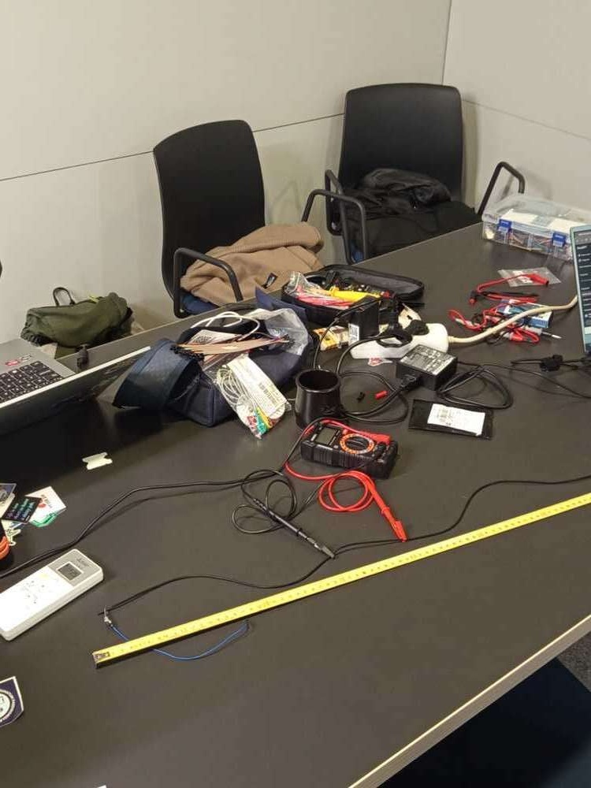
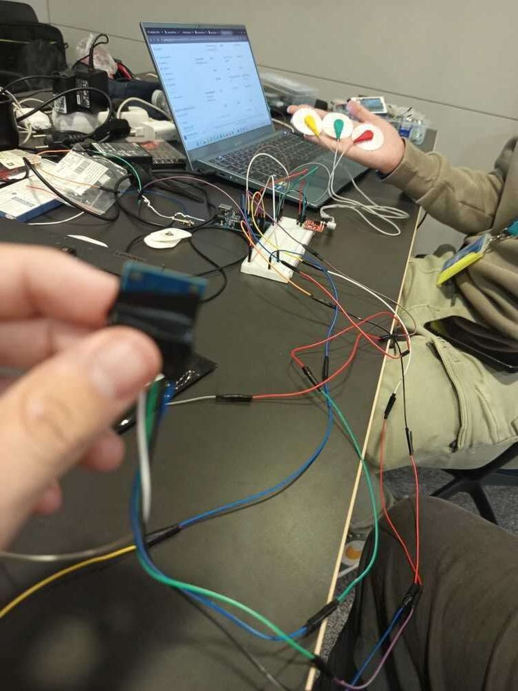
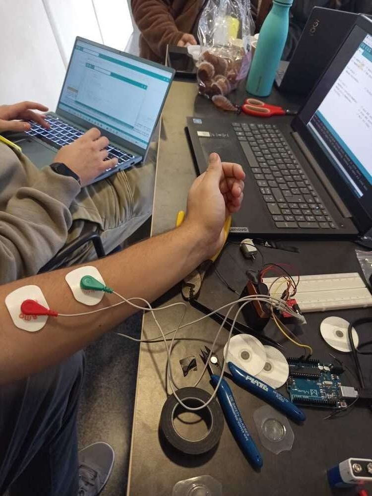
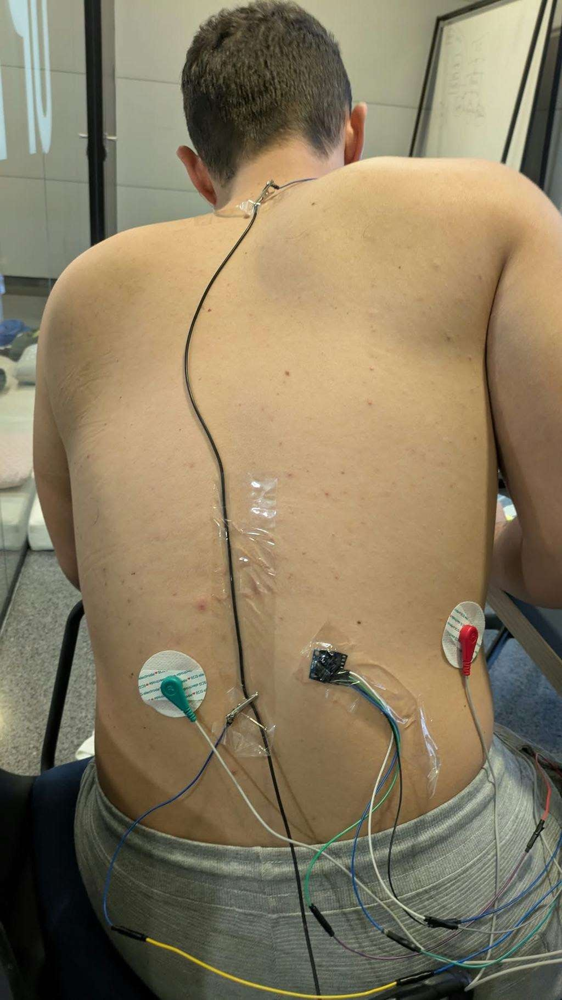
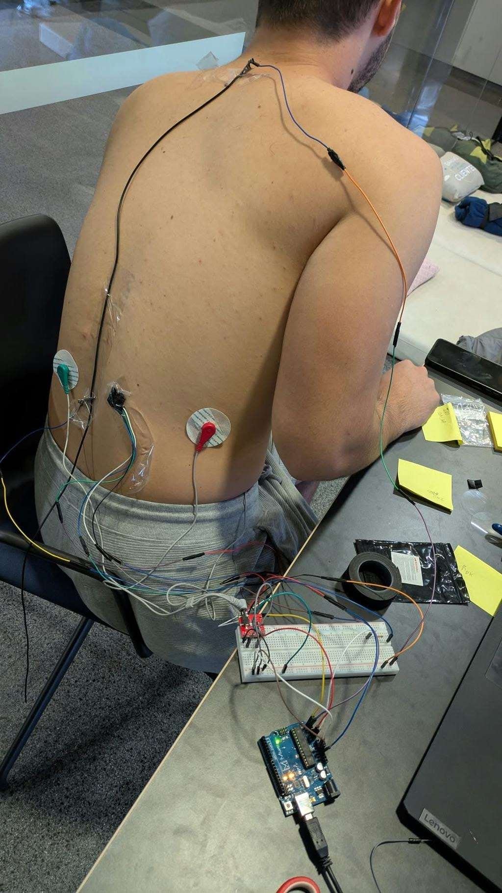
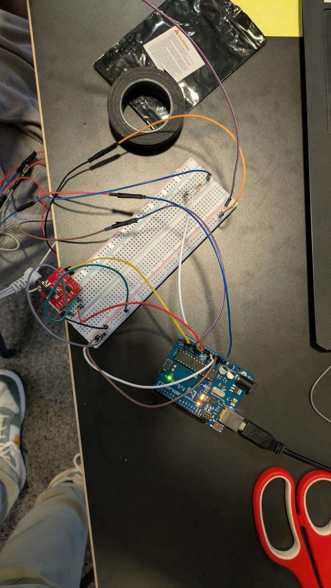
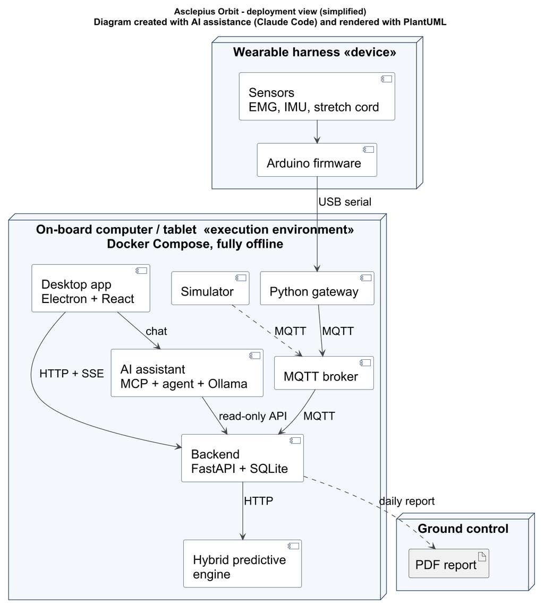

[English](README.md) · [Español](README.es.md) · **Català**

# nasa-hackathon

## El projecte

Asclepius Orbit és un dispositiu wearable i una aplicació experimental concebuts per ajudar els astronautes a seguir els canvis de l'esquena durant missions espacials llargues. En microgravetat canvien la columna i la musculatura de l'esquena, mentre que l'assistència mèdica pot trigar a arribar. El projecte combina mesuraments, referències individuals i un assistent sense connexió per facilitar la comprensió dels canvis i preparar informació per al metge de vol.

El sistema és una ajuda per a la presa de decisions, no un dispositiu mèdic validat. Les estimacions depenen de la qualitat dels sensors i de les hipòtesis utilitzades; els marges de disseny de la NASA són context, no llindars clínics.

### Prototip wearable

El prototip reuneix tres sensors:

- **Cordó elàstic:** un cordó conductor canvia de resistència quan s'estira. La submission descriu la col·locació de C3 a L5; el protocol d'exercici actual especifica de C3 a S1. La lectura és un indicador que necessita calibratge, no un mesurament directe de la longitud de la columna.
- **IMU:** un acceleròmetre i giroscopi MPU-6050 registra el moviment i l'orientació durant el repòs i l'exercici.
- **EMG:** uns elèctrodes connectats a un sensor muscular capten activitat elèctrica relacionada amb l'esforç del múscul.



*Preparació i mesura del cordó elàstic.*



*Connexió dels sensors i l'electrònica.*



*Muntatge i proves del prototip.*



*Col·locació dels sensors a l'esquena.*



*Muntatge wearable i connexions.*



*Arduino i circuit dels sensors.*

L'[sketch de mesura](docs/submission/codigo_TRES_SENSORES.ino) independent del prototip imprimeix les lectures dels tres sensors. La [guia de la submission](docs/submission/README.md#independent-measurement-sketch) compara els seus pins i format sèrie amb el [firmware integrat](firmware/README.ca.md).

### Programari i desplegament

L'Arduino envia les lectures a un gateway que publica la telemetria mitjançant MQTT. Un backend desa i serveix les dades, mentre que el motor analitza els senyals respecte d'una referència individual. L'aplicació d'escriptori mostra sessions, historial i informes; un assistent local utilitza eines de només lectura i Ollama per explicar la informació disponible. El sistema està dissenyat per funcionar sense connexió un cop preparats els recursos i el model.



*Diagrama simplificat de la submission, creat amb assistència d'IA i representat amb PlantUML.*

La demo utilitza per defecte el simulador de fisiologia. També hi ha un emulador d'Arduino que alimenta el gateway real sense necessitat de placa; l'equip informa de proves satisfactòries amb la placa física i resultats molt semblants als del simulador. Consulta la [guia de la submission](docs/submission/README.md) per veure l'explicació completa i les fonts, la [presentació](https://docs.google.com/presentation/d/1hYA3H3u4jRxNxBpVDf_YdBsfTKYevK9d/edit?usp=sharing&ouid=105292242329575172274&rtpof=true&sd=true) i la [submission de Space Apps](https://www.spaceappschallenge.org/2026/find-a-team/asclepius-orbit/?tab=project).

## Arquitectura del xat

```text
UI d'escriptori -- HTTP POST /chat + SSE --> Servidor HTTP de l'agent -- MCP --> Servidor MCP --> API de lectura del backend
                                                        |
                                                        +--> Ollama (LLM local)
```

La UI crida directament l'agent amb un token i `X-Astronaut-Id`. Tancar la connexió cancel·la la resposta. L'agent pot oferir una resposta alternativa determinista si el LLM no està disponible. Consulta la [guia de l'API de l'agent](spine_monitor/agent/README.ca.md) i el [contracte OpenAPI](spine_monitor/contracts/agent-openapi.yaml).

## Antropometria i evidència fora de línia

L'[inventari de fonts](docs/anthropometry-sources.md) recull guies de disseny de la NASA i un estudi relacionat, amb població, mètode, pàgines, limitacions i condicions de reutilització. Els valors de la NASA d'aproximadament el 3 % de l'estatura dreta i el 6 % de l'altura asseguda són marges de disseny de naus, no llindars clínics. Una predicció del motor és experimental: depèn de la referència terrestre individual en la mateixa postura, de la incertesa del sensor i de les hipòtesis indicades; estatura, altura asseguda i longitud estimada del cordó són magnituds diferents.

Les fonts revisades inclouen [NTRS 20110023150](https://ntrs.nasa.gov/citations/20110023150), [20090007782](https://ntrs.nasa.gov/citations/20090007782), [20090038743](https://ntrs.nasa.gov/citations/20090038743), [NASA-STD-3000 volum I](https://standards.nasa.gov/standard/NASA/NASA-STD-3000_VOL_I), [NASA-STD-3001 volum 2](https://standards.nasa.gov/node/237), el [Human Integration Design Handbook](https://www.nasa.gov/human-integration-design-handbook/) i l'[API NTRS](https://ntrs.nasa.gov/api/openapi/). L'inventari detalla versions, accés i límits; citar una font no implica que el text complet estigui inclòs en el corpus local.

Prepara l'equip amb connexió: instal·la les dependències fixades i les imatges Docker, configura el broker com s'indica a continuació i desa el model Ollama necessari. La [guia de l'agent](spine_monitor/agent/README.ca.md) descriu el volum de models i la configuració. Conserva aquest volum i els recursos d'evidència locals quan traslladis o actualitzis una instal·lació fora de línia; `docker compose down -v` esborra el volum de models. Comprova que el model exacte i els recursos hi siguin abans de desconnectar. `ollama-pull` pertany al perfil explícit `llm-prepare` i descarrega els models que faltin; no l'executis sense connexió. Per iniciar en una màquina ja preparada, fes servir el perfil `llm`, que engega Ollama sense descarregar models:

```bash
docker compose -f app/docker-compose.yml --profile llm up -d
cd spine_monitor
uv run spine-agent --astronaut AST-01
```

L'aplicació pot respondre amb el resum determinista si Ollama no està disponible, però no generarà una resposta de model sense el model local. Un informe generat ha de citar ubicacions comprovables de les fonts o indicar que l'evidència és insuficient.

El corpus inclòs i el seu índex vectorial lèxic dispers són fitxers locals. Després d'actualitzar el corpus, reconstrueix l'índex corresponent des de `spine_monitor/` (no cal Internet):

```bash
uv run python -c "from pathlib import Path; from spine_mcp_server.evidence import build_index; p=Path('mcp_server/src/spine_mcp_server/evidence_data'); build_index(p/'corpus.json', p/'index.json')"
```

Copia tots dos fitxers junts en instal·lar o actualitzar fora de línia. `SPINE_EVIDENCE_DIR` pot apuntar al seu directori. Si falten, són invàlids o no coincideixen, la recuperació falla de manera explícita; l'índex no descarrega evidència ni proporciona embeddings semàntics.

## Entorn de desenvolupament (Python)

`spine_monitor/` és un workspace d'uv: un sol `.venv` i un sol `uv.lock` per a tots els paquets. Treballa sempre des de `spine_monitor/` (`uv sync --all-packages`, `uv run pytest`). A PyCharm, obre la carpeta `spine_monitor/` i tria com a intèrpret el seu `.venv`.

Docker Compose (`app/docker-compose.yml`): el broker MQTT exigeix usuaris i ACL, i les seves credencials mai no són al repo. Executa `sh app/mosquitto/setup.sh` un cop abans de qualsevol `docker compose` (Git Bash a Windows); les escriu a `app/.env` (al `.gitignore`). Els usuaris, l'alta de dispositius i l'accés per la LAN amb TLS són a [spine_monitor/backend/README.ca.md](spine_monitor/backend/README.ca.md).
## Gateway del wearable

El gateway real del wearable (`spine_monitor/gateway`) llegeix l'Arduino per USB sèrie i publica al bus MQTT v1; el sketch és a `firmware/`. Una demo sense hardware executa el gateway contra un emulador de l'Arduino:

```bash
docker compose -f app/docker-compose.yml --profile gateway-demo up -d arduino-emulator gateway-demo
```

El context de build és l'arrel del repo: si Docker no pot llegir-lo per carpetes il·legibles (restes de directoris temporals a Windows), elimina-les o construeix des d'un clon net. Vegeu [`spine_monitor/gateway/README.ca.md`](spine_monitor/gateway/README.ca.md) (execució, configuració, cablejat i prova amb la placa) i [`firmware/README.ca.md`](firmware/README.ca.md) (sketch i protocol sèrie).

## Font de telemetria: simulador o dispositiu

`SPINE_APP_TELEMETRY_SOURCE` (a `app/.env` o a l'entorn) tria l'únic productor de telemetria de tota l'app: `simulator` (per defecte) o `device`. El backend només accepta aquesta `source`; qualsevol altre valor impedeix l'arrencada amb `SPINE_APP_TELEMETRY_SOURCE must be one of: simulator, device (got 'x')`. `SPINE_GATEWAY_DEMO=1` (per defecte `0`) fa que `device` usi l'emulador sèrie en lloc d'una placa; exigeix `device` i `start-demo.ps1` el rebutja amb `simulator`.

| Font | Productor (perfil de Compose) | Requisit de Docker |
|---|---|---|
| `simulator` | simulador de fisiologia (`sim`) | Docker Compose |
| `device` | gateway real + Arduino per USB (`hardware`) | Docker ha de tenir accés al dispositiu sèrie de la placa |
| `device` + `SPINE_GATEWAY_DEMO=1` | gateway + emulador d'Arduino (`gateway-demo`), sense placa | Docker Compose; no necessita dispositiu USB |

L'equip ha executat el projecte amb Docker en portàtils Windows. L'equip informa de proves satisfactòries amb placa física, amb resultats molt semblants als del simulador; l'accés sèrie depèn de l'entorn de Docker triat.

Regla: un sol productor alhora, mai simulador i gateway junts. Només `app/start-demo.ps1` ho imposa; compondre els perfils a mà encara permet barrejar-los.

Per reproduir-ho (des de l'arrel del repo, amb Docker):

```bash
sh app/mosquitto/setup.sh                                  # un cop: credencials a app/.env
powershell -File app/start-demo.ps1                        # simulador (per defecte)
SPINE_APP_TELEMETRY_SOURCE=device SPINE_GATEWAY_DEMO=1 powershell -File app/start-demo.ps1   # dispositiu amb emulador
```

A PowerShell defineix les variables amb `$env:NOM='valor'` o escriu-les a `app/.env`; `-NoUi` omet l'app d'escriptori.

El backend descarta (avís al log, comptador `wrong_source`) tot missatge de stream, status o calibratge amb una `source` diferent de la configurada, `replay` inclòs. `ack` i `clock` no porten `source`, així que no es filtren. En mode dispositiu el Last Will offline del gateway sempre guanya a l'estat del dispositiu.

Per verificar-ho (atura abans l'stack de desenvolupament: tots dos necessiten lliures els ports 1883, 8000 i 8001):

```bash
cd spine_monitor && SPINE_REQUIRE_BROKER=1 uv run pytest tests/test_e2e_telemetry_source.py   # Mosquitto real, tots dos modes
cd app/ui && pnpm run e2e:real          # UI contra el simulador
cd app/ui && pnpm run e2e:real:device   # UI contra gateway + emulador
```

## Skills de Claude Code per a pull requests

Dues skills del projecte a `.claude/skills/` porten la revisió de PRs amb subagents:

- `review-pr`: revisa una PR. Primer llegeix la PR, la issue enllaçada, el CI i els fils; llança revisors en paral·lel (correcció, tests/TDD, seguretat), verifica cada bloquejant i publica una sola review amb `gh`: request changes amb suggeriments inline si hi ha bloquejants, aprovació si només hi ha errors d'estil. A la teva pròpia PR GitHub no permet un veredicte formal, així que publica una review `COMMENT` la primera línia de la qual és el veredicte.
- `receive-review`: aplica els canvis demanats en una PR. Contrasta cada comentari amb el codi, fa rebase sobre `develop`, aplica les correccions amb TDD, arregla el CI trencat, torna a passar el gate de qualitat, empeny amb `--force-with-lease`, resol els fils i re-sol·licita la review.

Totes dues demanen confirmació abans de publicar, fer commit o empènyer, i mai afegeixen atribució a Claude.

## Skills i eines de tercers

Skills copiades a `.claude/skills/` (procedència i llicències a `.claude/skills/THIRD_PARTY.md`):

- `mcp-builder`: disseny de servidors MCP i els seus evals (per a `mcp_server`).
- `property-based-testing`: propietats de Hypothesis per a `physiology` i `engine`.
- `modern-python`: convencions d'uv i ruff. El seu consell d'usar `ty` no aplica: aquest repo comprova tipus amb pyright.
- `async-python-patterns`, `python-testing-patterns`, `python-type-safety`: referències d'asyncio, pytest i tipat.

El `.mcp.json` del projecte registra Context7 (versió fixada) perquè Claude Code consulti documentació actual de FastAPI, aiomqtt, l'SDK `mcp`, numpy i pydantic. Envia les consultes a Upstash.

Skills de projecte per al domini: `physiology-engine`, `contract-first`, `agent-evals`, `mqtt-dev` i `mcp-tool-change`.

`.claude/skills/ROUTING.md` assigna a cada tipus de tasca les skills que li apliquen. `implement-feature`, `tdd-workflow`, `review-pr` i `receive-review` l'usen per anomenar aquestes skills als prompts dels subagents.

El tooling de Node usa només pnpm (`pnpm install`, `pnpm run`, `pnpm dlx`); mai npm ni npx. El lockfile és `app/ui/pnpm-lock.yaml`.

Dependències noves: `pint` (unitats, a `physiology`), `pydantic-evals` (dev, per als evals de l'agent), i `vitest` i `uplot` (dev, a `app/ui`).

## Logo

El logo d'Asclepius Orbit (`app/ui/build/icon.png` i `app/ui/src/renderer/assets/logo.png`) ha estat generat amb IA per OpenAI.

## Llicència

Tots els drets reservats fins al **15-11-2026 a les 11:59 (Europe/Madrid)**; a partir d'aquell moment el repositori es llicencia sota la GNU General Public License v3. Els termes són a [`LICENSE`](LICENSE). El material de tercers, com tot el que hi ha a `.claude/skills/`, manté la seva pròpia llicència i no està cobert (vegeu [`.claude/skills/THIRD_PARTY.md`](.claude/skills/THIRD_PARTY.md)).

## Fonts i recursos

Consulta l’[inventari de recursos del projecte](docs/project-resources.md) per a les dades de la NASA, referències científiques, maquinari, programari, llicències i declaració d’ús d’IA.
