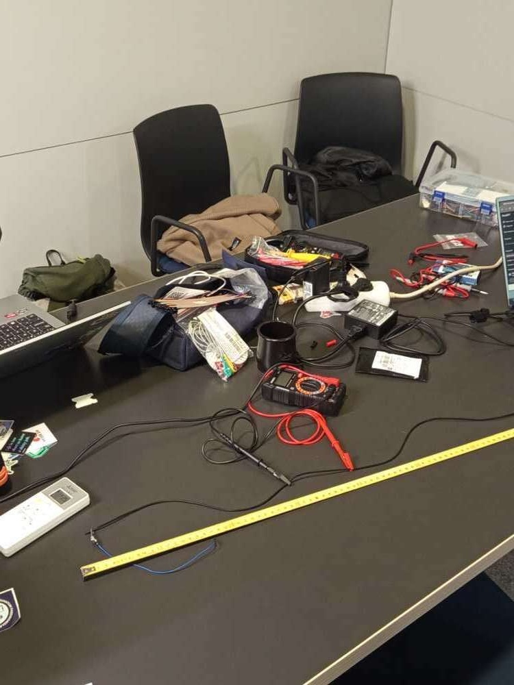
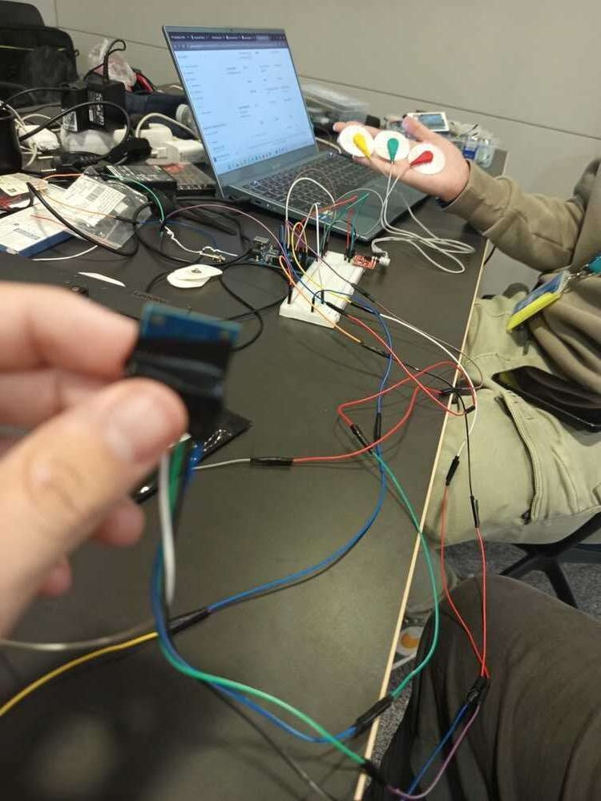
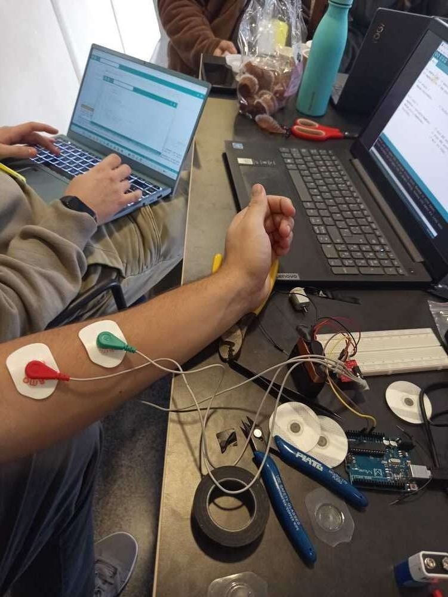
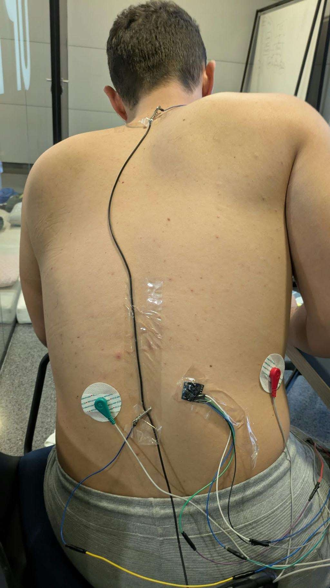
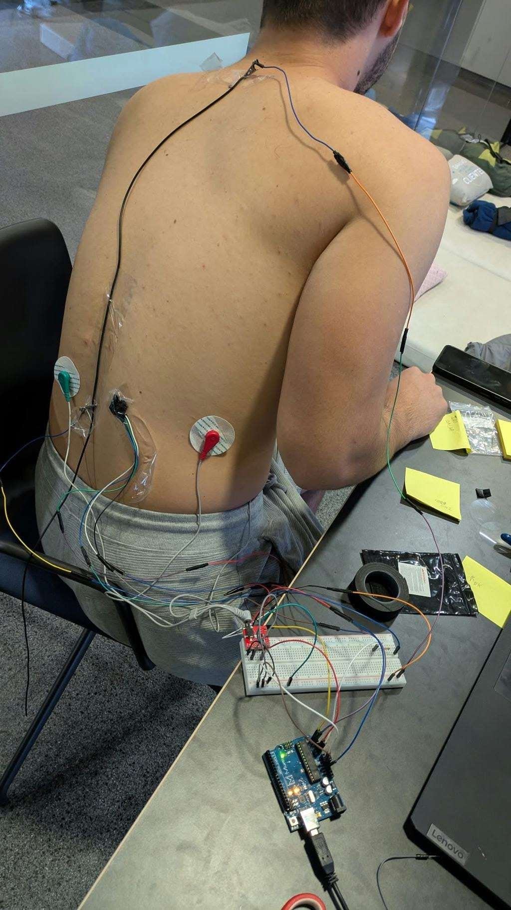
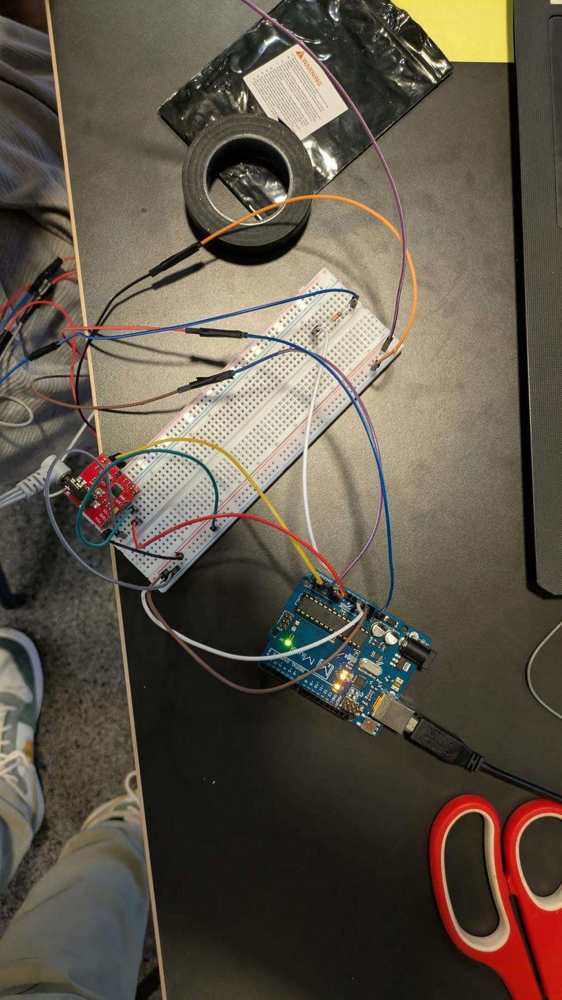
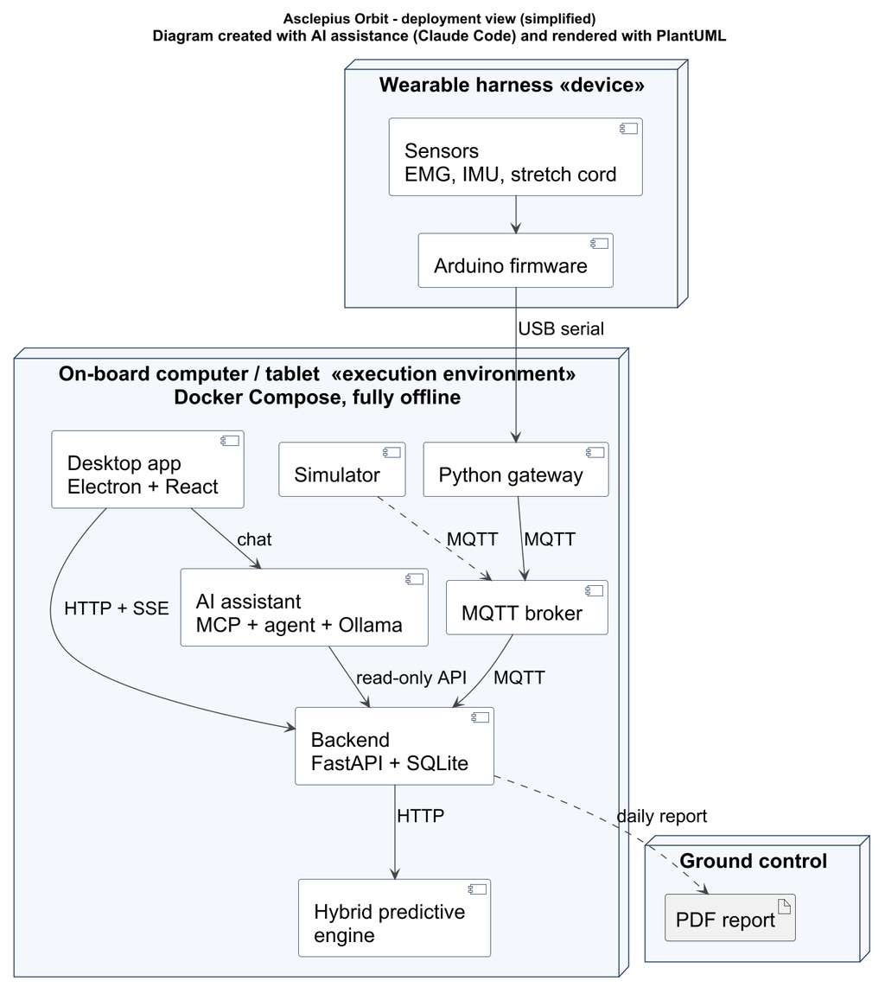

[English](README.md) · **Español** · [Català](README.ca.md)

# nasa-hackathon

## El proyecto

Asclepius Orbit es un dispositivo wearable y una aplicación experimental concebidos para ayudar a los astronautas a seguir los cambios de su espalda durante misiones espaciales largas. En microgravedad cambian la columna y la musculatura de la espalda, mientras que la asistencia médica puede tardar en llegar. El proyecto combina mediciones, referencias individuales y un asistente sin conexión para facilitar la comprensión de los cambios y preparar información para el médico de vuelo.

El sistema es una ayuda para la toma de decisiones, no un dispositivo médico validado. Sus estimaciones dependen de la calidad de los sensores y de las hipótesis utilizadas; los márgenes de diseño de la NASA son contexto, no umbrales clínicos.

### Prototipo wearable

El prototipo reúne tres sensores:

- **Cordón elástico:** un cordón conductor cambia de resistencia al estirarse. La submission describe su colocación de C3 a L5; el protocolo de ejercicio actual especifica de C3 a S1. Su lectura es un indicador que necesita calibración, no una medición directa de la longitud de la columna.
- **IMU:** un acelerómetro y giroscopio MPU-6050 registra el movimiento y la orientación durante el reposo y el ejercicio.
- **EMG:** unos electrodos conectados a un sensor muscular captan actividad eléctrica relacionada con el esfuerzo del músculo.



*Preparación y medición del cordón elástico.*



*Conexión de los sensores y la electrónica.*



*Montaje y pruebas del prototipo.*



*Colocación de los sensores en la espalda.*



*Montaje wearable y conexiones.*



*Arduino y circuito de los sensores.*

El [sketch de medición](docs/submission/codigo_TRES_SENSORES.ino) independiente del prototipo imprime las lecturas de los tres sensores. La [guía de la submission](docs/submission/README.md#independent-measurement-sketch) compara sus pines y formato serie con el [firmware integrado](firmware/README.es.md).

### Software y despliegue

El Arduino envía las lecturas a un gateway que publica la telemetría mediante MQTT. Un backend guarda y sirve los datos, mientras el motor analiza las señales respecto a una referencia individual. La aplicación de escritorio muestra sesiones, historial e informes; un asistente local utiliza herramientas de solo lectura y Ollama para explicar la información disponible. El sistema está diseñado para funcionar sin conexión una vez preparados sus recursos y el modelo.



*Diagrama simplificado de la submission, creado con asistencia de IA y representado con PlantUML.*

La demo utiliza por defecto el simulador de fisiología. También hay un emulador de Arduino que alimenta el gateway real sin necesidad de placa; el equipo informa de pruebas satisfactorias con la placa física y resultados muy similares a los del simulador. Consulta la [guía de la submission](docs/submission/README.md) para ver la explicación completa y las fuentes, la [presentación](https://docs.google.com/presentation/d/1hYA3H3u4jRxNxBpVDf_YdBsfTKYevK9d/edit?usp=sharing&ouid=105292242329575172274&rtpof=true&sd=true) y la [submission de Space Apps](https://www.spaceappschallenge.org/2026/find-a-team/asclepius-orbit/?tab=project).

## Arquitectura del chat

```text
UI de escritorio -- HTTP POST /chat + SSE --> Servidor HTTP del agente -- MCP --> Servidor MCP --> API de lectura del backend
                                                        |
                                                        +--> Ollama (LLM local)
```

La UI llama directamente al agente con un token y `X-Astronaut-Id`. Cerrar la conexión cancela la respuesta. El agente puede ofrecer una respuesta alternativa determinista si el LLM no está disponible. Consulta la [guía de la API del agente](spine_monitor/agent/README.es.md) y el [contrato OpenAPI](spine_monitor/contracts/agent-openapi.yaml).

## Antropometría y evidencia offline

El [inventario de fuentes](docs/anthropometry-sources.md) recoge guías de diseño de NASA y un estudio relacionado, con población, método, páginas, limitaciones y condiciones de reutilización. Los valores de NASA de aproximadamente el 3 % de la estatura de pie y el 6 % de la altura sentada son márgenes de diseño de naves, no umbrales clínicos. Una predicción del motor es experimental: depende de la referencia terrestre individual en la misma postura, la incertidumbre del sensor y las hipótesis indicadas; estatura, altura sentada y longitud estimada del cordón son magnitudes distintas.

Las fuentes revisadas incluyen [NTRS 20110023150](https://ntrs.nasa.gov/citations/20110023150), [20090007782](https://ntrs.nasa.gov/citations/20090007782), [20090038743](https://ntrs.nasa.gov/citations/20090038743), [NASA-STD-3000 volumen I](https://standards.nasa.gov/standard/NASA/NASA-STD-3000_VOL_I), [NASA-STD-3001 volumen 2](https://standards.nasa.gov/node/237), el [Human Integration Design Handbook](https://www.nasa.gov/human-integration-design-handbook/) y la [API NTRS](https://ntrs.nasa.gov/api/openapi/). El inventario detalla versiones, acceso y límites; citar una fuente no implica que su texto completo esté incluido en el corpus local.

Prepara el equipo con conexión: instala las dependencias fijadas y las imágenes Docker, configura el broker como se indica abajo y guarda el modelo Ollama necesario. La [guía del agente](spine_monitor/agent/README.es.md) describe el volumen de modelos y su configuración. Conserva ese volumen y los recursos de evidencia locales al trasladar o actualizar una instalación offline; `docker compose down -v` borra el volumen de modelos. Comprueba que estén presentes el modelo exacto y los recursos antes de desconectar. `ollama-pull` pertenece al perfil explícito `llm-prepare` y descarga los modelos que falten; no lo ejecutes sin conexión. Para iniciar en una máquina ya preparada, usa el perfil `llm`, que arranca Ollama sin descargar modelos:

```bash
docker compose -f app/docker-compose.yml --profile llm up -d
cd spine_monitor
uv run spine-agent --astronaut AST-01
```

La aplicación puede contestar con el resumen determinista si Ollama no está disponible, pero no generará una respuesta de modelo sin el modelo local. Un informe generado debe citar ubicaciones comprobables de las fuentes o indicar que la evidencia es insuficiente.

El corpus incluido y su índice vectorial léxico disperso son archivos locales. Después de actualizar el corpus, reconstruye el índice correspondiente desde `spine_monitor/` (no hace falta Internet):

```bash
uv run python -c "from pathlib import Path; from spine_mcp_server.evidence import build_index; p=Path('mcp_server/src/spine_mcp_server/evidence_data'); build_index(p/'corpus.json', p/'index.json')"
```

Copia ambos archivos juntos al instalar o actualizar sin conexión. `SPINE_EVIDENCE_DIR` puede apuntar a su directorio. Si faltan, son inválidos o no coinciden, la recuperación falla de forma explícita; el índice no descarga evidencia ni proporciona embeddings semánticos.

## Entorno de desarrollo (Python)

`spine_monitor/` es un workspace de uv: un solo `.venv` y un solo `uv.lock` para todos los paquetes. Trabaja siempre desde `spine_monitor/` (`uv sync --all-packages`, `uv run pytest`). En PyCharm, abre la carpeta `spine_monitor/` y elige como intérprete su `.venv`.

Docker Compose (`app/docker-compose.yml`): el broker MQTT exige usuarios y ACL, y sus credenciales nunca están en el repo. Ejecuta `sh app/mosquitto/setup.sh` una vez antes de cualquier `docker compose` (Git Bash en Windows); las escribe en `app/.env` (en `.gitignore`). Los usuarios, el alta de dispositivos y el acceso por la LAN con TLS están en [spine_monitor/backend/README.es.md](spine_monitor/backend/README.es.md).
## Gateway del wearable

El gateway real del wearable (`spine_monitor/gateway`) lee el Arduino por USB serie y publica en el bus MQTT v1; el sketch está en `firmware/`. Una demo sin hardware ejecuta el gateway contra un emulador del Arduino:

```bash
docker compose -f app/docker-compose.yml --profile gateway-demo up -d arduino-emulator gateway-demo
```

El contexto de build es la raíz del repo: si Docker no puede leerlo por carpetas ilegibles (restos de directorios temporales en Windows), elimínalas o construye desde un clon limpio. Ver [`spine_monitor/gateway/README.es.md`](spine_monitor/gateway/README.es.md) (ejecución, configuración, cableado y prueba con la placa) y [`firmware/README.es.md`](firmware/README.es.md) (sketch y protocolo serie).

## Fuente de telemetría: simulador o dispositivo

`SPINE_APP_TELEMETRY_SOURCE` (en `app/.env` o en el entorno) elige el único productor de telemetría de toda la app: `simulator` (por defecto) o `device`. El backend solo acepta esa `source`; cualquier otro valor impide arrancar con `SPINE_APP_TELEMETRY_SOURCE must be one of: simulator, device (got 'x')`. `SPINE_GATEWAY_DEMO=1` (por defecto `0`) hace que `device` use el emulador serie en vez de una placa; exige `device` y `start-demo.ps1` lo rechaza con `simulator`.

| Fuente | Productor (perfil de Compose) | Requisito de Docker |
|---|---|---|
| `simulator` | simulador de fisiología (`sim`) | Docker Compose |
| `device` | gateway real + Arduino por USB (`hardware`) | Docker debe tener acceso al dispositivo serie de la placa |
| `device` + `SPINE_GATEWAY_DEMO=1` | gateway + emulador de Arduino (`gateway-demo`), sin placa | Docker Compose; no necesita dispositivo USB |

El equipo ha ejecutado el proyecto con Docker en portátiles Windows. El equipo informa de pruebas satisfactorias con placa física, con resultados muy similares a los del simulador; el acceso serie depende del entorno de Docker elegido.

Regla: un solo productor a la vez, nunca simulador y gateway juntos. Solo `app/start-demo.ps1` lo impone; componer los perfiles a mano todavía permite mezclarlos.

Para reproducirlo (desde la raíz del repo, con Docker):

```bash
sh app/mosquitto/setup.sh                                  # una vez: credenciales en app/.env
powershell -File app/start-demo.ps1                        # simulador (por defecto)
SPINE_APP_TELEMETRY_SOURCE=device SPINE_GATEWAY_DEMO=1 powershell -File app/start-demo.ps1   # dispositivo con emulador
```

En PowerShell define las variables con `$env:NOMBRE='valor'` o escríbelas en `app/.env`; `-NoUi` omite la app de escritorio.

El backend descarta (aviso en el log, contador `wrong_source`) todo mensaje de stream, status o calibración cuya `source` difiera de la configurada, incluido `replay`. `ack` y `clock` no llevan `source`, así que no se filtran. En modo dispositivo el Last Will offline del gateway siempre gana en el estado del dispositivo.

Para verificarlo (para antes el stack de desarrollo: ambos necesitan libres los puertos 1883, 8000 y 8001):

```bash
cd spine_monitor && SPINE_REQUIRE_BROKER=1 uv run pytest tests/test_e2e_telemetry_source.py   # Mosquitto real, ambos modos
cd app/ui && pnpm run e2e:real          # UI contra el simulador
cd app/ui && pnpm run e2e:real:device   # UI contra gateway + emulador
```

## Skills de Claude Code para pull requests

Dos skills del proyecto en `.claude/skills/` llevan la revisión de PRs con subagentes:

- `review-pr`: revisa una PR. Primero lee la PR, la issue enlazada, el CI y los hilos; lanza revisores en paralelo (corrección, tests/TDD, seguridad), verifica cada bloqueante y publica una sola review con `gh`: request changes con sugerencias inline si hay bloqueantes, aprobación si solo hay fallos de estilo. En tu propia PR GitHub no permite un veredicto formal, así que publica una review `COMMENT` cuya primera línea es el veredicto.
- `receive-review`: aplica los cambios pedidos en una PR. Contrasta cada comentario con el código, hace rebase sobre `develop`, aplica los arreglos con TDD, arregla el CI roto, vuelve a pasar el gate de calidad, empuja con `--force-with-lease`, resuelve los hilos y re-solicita la review.

Ambas piden confirmación antes de publicar, commitear o empujar, y nunca añaden atribución a Claude.

## Skills y herramientas de terceros

Skills copiadas en `.claude/skills/` (procedencia y licencias en `.claude/skills/THIRD_PARTY.md`):

- `mcp-builder`: diseño de servidores MCP y sus evals (para `mcp_server`).
- `property-based-testing`: propiedades de Hypothesis para `physiology` y `engine`.
- `modern-python`: convenciones de uv y ruff. Su consejo de usar `ty` no aplica: este repo comprueba tipos con pyright.
- `async-python-patterns`, `python-testing-patterns`, `python-type-safety`: referencias de asyncio, pytest y tipado.

El `.mcp.json` del proyecto registra Context7 (versión fijada) para que Claude Code consulte documentación actual de FastAPI, aiomqtt, el SDK `mcp`, numpy y pydantic. Envía las consultas a Upstash.

Skills de proyecto para el dominio: `physiology-engine`, `contract-first`, `agent-evals`, `mqtt-dev` y `mcp-tool-change`.

`.claude/skills/ROUTING.md` asigna a cada tipo de tarea las skills que le aplican. `implement-feature`, `tdd-workflow`, `review-pr` y `receive-review` lo usan para nombrar esas skills en los prompts de los subagentes.

El tooling de Node usa solo pnpm (`pnpm install`, `pnpm run`, `pnpm dlx`); nunca npm ni npx. El lockfile es `app/ui/pnpm-lock.yaml`.

Dependencias nuevas: `pint` (unidades, en `physiology`), `pydantic-evals` (dev, para evals del agente), y `vitest` y `uplot` (dev, en `app/ui`).

## Logo

El logo de Asclepius Orbit (`app/ui/build/icon.png` y `app/ui/src/renderer/assets/logo.png`) ha sido generado con IA por OpenAI.

## Licencia

Todos los derechos reservados hasta el **15-11-2026 a las 11:59 (Europe/Madrid)**; a partir de ese momento el repositorio se licencia bajo la GNU General Public License v3. Los términos están en [`LICENSE`](LICENSE). El material de terceros, como todo lo que hay en `.claude/skills/`, mantiene su propia licencia y no está cubierto (ver [`.claude/skills/THIRD_PARTY.md`](.claude/skills/THIRD_PARTY.md)).

## Fuentes y recursos

Consulta el [inventario de recursos del proyecto](docs/project-resources.md) para los datos de la NASA, referencias científicas, hardware, software, licencias y declaración de uso de IA.
