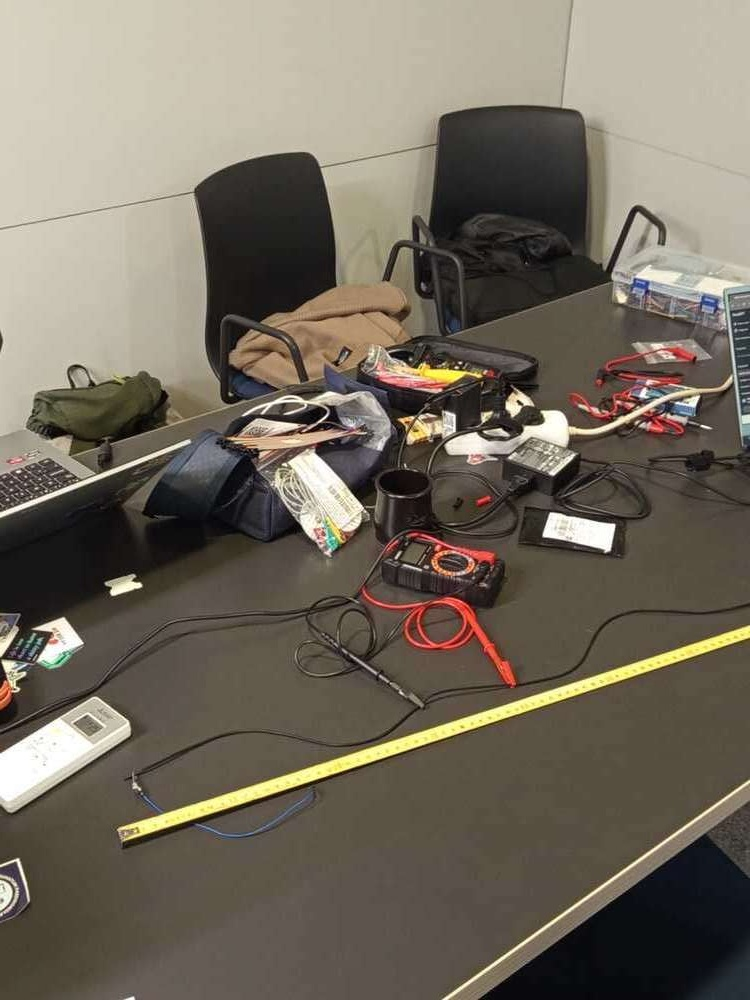
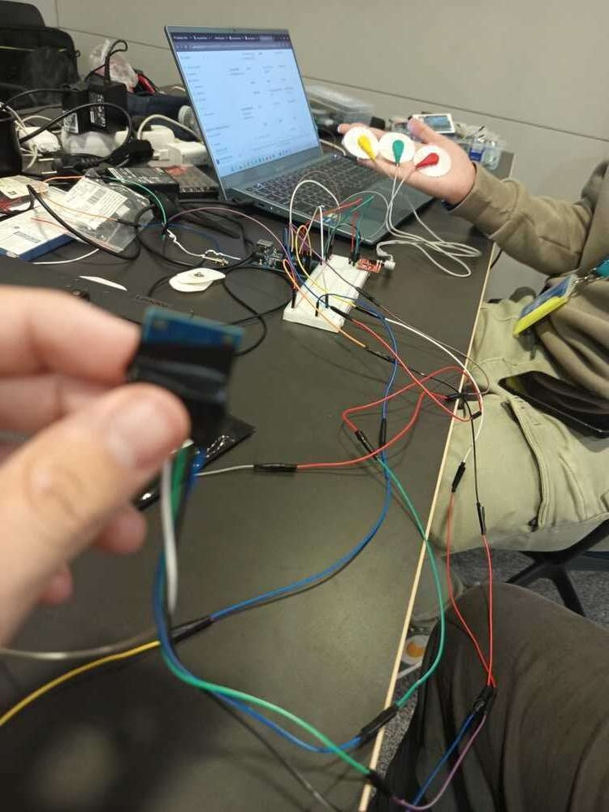
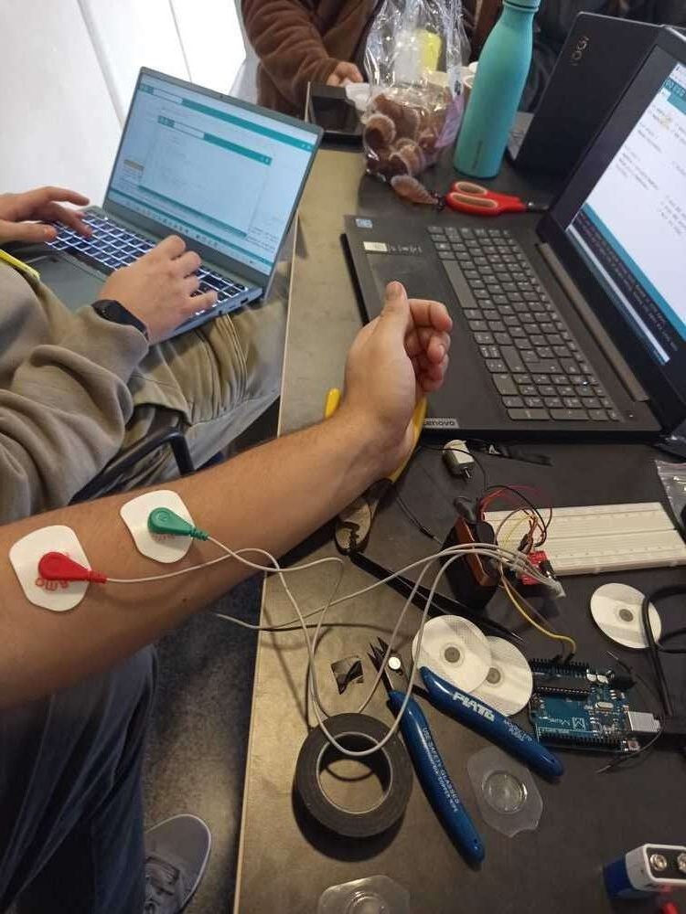
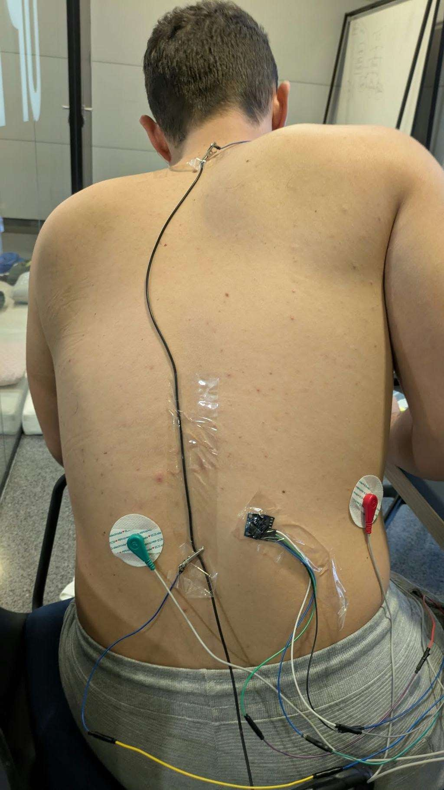
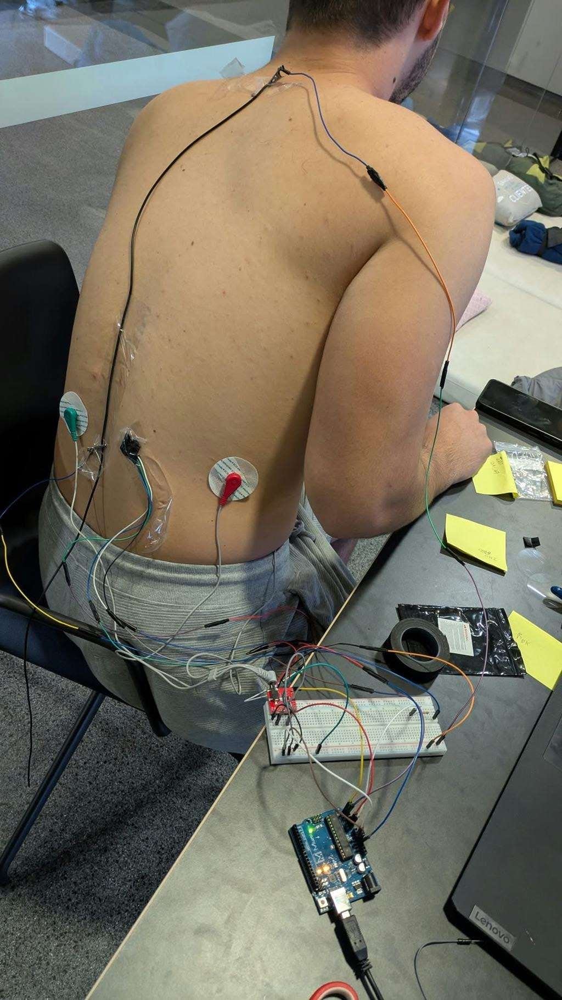
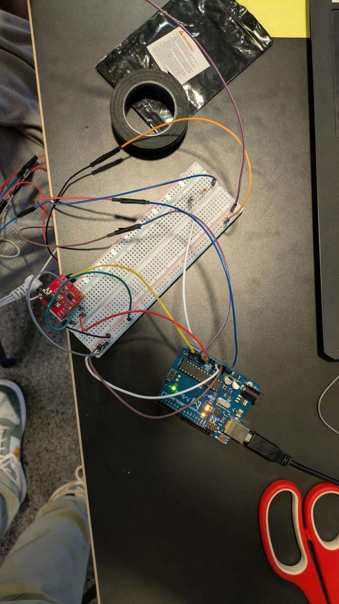
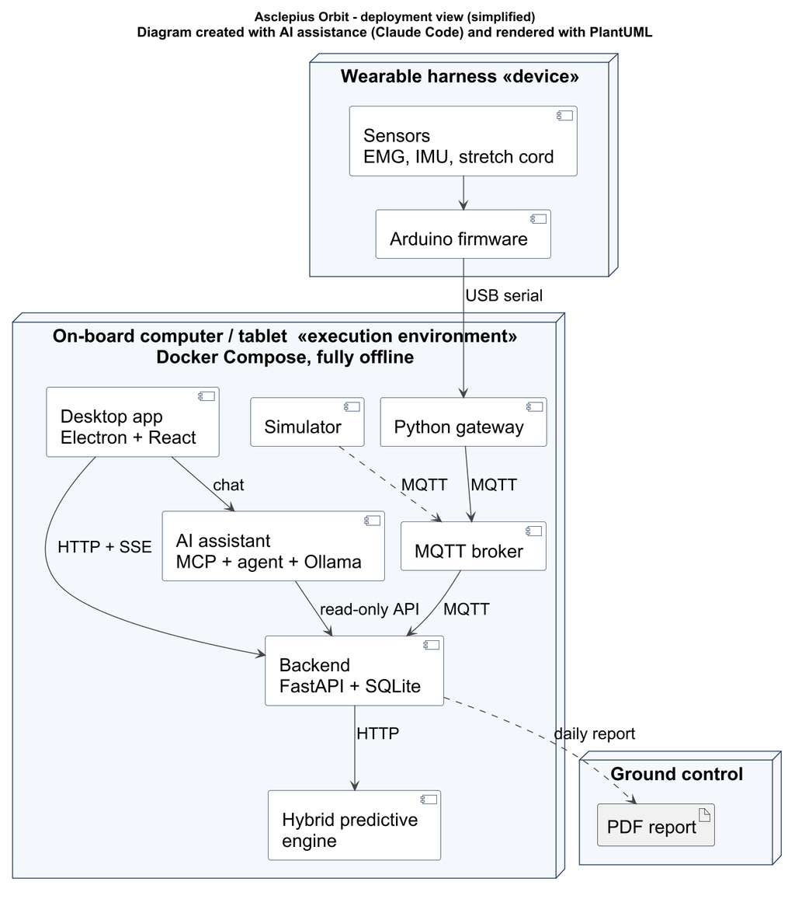

# Asclepius Orbit: Space Apps submission

This guide brings together the physical measurement prototype and the software described in the [Space Apps project submission](https://www.spaceappschallenge.org/2026/find-a-team/asclepius-orbit/?tab=project). The [presentation](https://docs.google.com/presentation/d/1hYA3H3u4jRxNxBpVDf_YdBsfTKYevK9d/edit?usp=sharing&ouid=105292242329575172274&rtpof=true&sd=true) is the project demonstration. This guide is a readable account of the submission, with current implementation limitations made explicit.

## Challenge and summary

Long missions expose astronauts to isolation, altered gravity and a closed environment while medical support may be delayed. In microgravity, spinal unloading changes the back and may contribute to pain and injury. Asclepius Orbit proposes a wearable harness and local application to follow spinal change and muscle activity, help the crew understand changes over time, and prepare reports for ground support. It is an experimental monitoring concept, not a validated clinical device or diagnostic system.

The submission is organised around the summary, project demonstration, project details, NASA data and other resources. It describes a physical sensor assembly and a separate software stack. Its photographs document assembly and placement.

## Project details: hardware

The prototype combines three measurements:

- A conductive stretch cord along the back changes resistance with elongation. The submission describes placement from C3 to L5; the later [exercise protocol](../protocolo-ejercicio.md) specifies C3 to S1. A voltage divider provides an analog reading; the submission proposes comparing changes in the cord with spinal elongation. This is a proxy requiring calibration, not a direct measurement of spinal or spinal cord length.
- An MPU-6050 accelerometer and gyroscope tracks movement and orientation. The submission proposes comparing motion or posture on Earth and in space.
- An EMG module with electrodes records muscle electrical activity as a possible indicator of effort and fatigue. Signal interpretation depends on the module, placement and validation.



*Submission pages 5–6: measuring the stretch cord and preparing the components.*



*Pages 7–8: electronics and electrodes during assembly.*



*Pages 9–10: prototype assembly and initial measurements.*



*Pages 11–13: placement of the cord, motion sensor and electrodes on the back.*



*Pages 14–16: wearable assembly and connections.*



*Pages 17–19: Arduino, breadboard and sensor connections.*

### Independent measurement sketch

The supplied [codigo_TRES_SENSORES.ino](codigo_TRES_SENSORES.ino) is the independent prototype sketch. It reads a resistive divider on **A0** and EMG on **A1**, wakes the MPU-6050 at I²C address `0x68`, calibrates gyro offsets using 500 samples, and computes two angles using a complementary filter. At 9600 baud it prints labelled human-readable readings and delays 200 ms per loop. A representative excerpt is:

```cpp
const int sensorResPin = A0;
const int emgPin = A1;
// ...
Serial.print("[RESISTIVO] Voltaje: "); Serial.print(voltaje);
Serial.print(" V | Resistencia: "); Serial.print(resistencia); Serial.println(" ohms");
Serial.print("[EMG] Valor crudo: "); Serial.println(emgValue);
```

The repository's [integrated firmware](../../firmware/README.md) instead uses **A0 for EMG and A1 for the cord**, with MPU-6050 on I²C (Uno A4/A5). It sends CRC-protected, base64-encoded v1 serial batches at 9600 baud, with nominal EMG, IMU and cord sampling rates of 1000, 100 and 20 Hz respectively. The two sketches are not serial-protocol compatible; do not connect the prototype sketch to the gateway expecting v1 frames. The integrated firmware's own comments warn that its average data rate exceeds the capacity of 9600-baud serial, which can cause dropped batches.

## Project details: software and deployment

The submission describes an offline-first system: sensors and Arduino feed a Python gateway over serial; gateway or simulator publishes via MQTT; the backend stores and exposes data; an engine produces experimental features and predictions; a desktop application presents sessions; and an agent uses MCP and a local Ollama model to answer questions and prepare reports. The diagram below is the submission's simplified deployment view, rather than proof that every path has been validated on hardware.



*Submission pages 21–22: simplified UML deployment view, created with AI assistance and rendered with PlantUML.*

The project emphasises local operation, a deterministic fallback when a model is unavailable, observable signal quality, and reproducible testing. Preparing an offline installation still requires the model and evidence resources to be present in advance; see the [main README](../../README.md) and [agent guide](../../spine_monitor/agent/README.md). Predictions use assumptions and an individual baseline; NASA design allowances are not clinical thresholds. The [exercise protocol](../protocolo-ejercicio.md) and [anthropometry inventory](../anthropometry-sources.md) record the measurement context and limitations.

The submission's architecture rationale is offline operation, read-only assistant access, explanations and individual baselines, signal-quality handling and verifiable interfaces. It describes a traffic-light assessment with reasons, confidence and missing data, immediate escalation of red-flag symptoms, and fault injection for sensor loss, motion artefacts, packet loss, reboots and clock drift. These are design and implementation goals, not proof of clinical reliability.

The submission describes the software components as follows:

- **Firmware and gateway:** the firmware samples the three streams and emits CRC-protected serial frames. The Python gateway checks and assembles frames, handles commands and calibration, and publishes to MQTT with QoS 1, a last will and reconnect backoff. See the [gateway guide](../../spine_monitor/gateway/README.md) for supported behaviour and the limitations above.
- **Broker and simulator:** Mosquitto provides authenticated MQTT with device ACLs and schema-validated messages. The physiology simulator replaces the wearable in the pipeline and models exercise, fatigue, microgravity, deconditioning and faults, with ground truth for tests.
- **Backend:** FastAPI and SQLite ingest telemetry, deduplicate chunks, store sessions, self-reports and assessments, send device commands and provide reports and live updates. A read-only API supplies the assistant.
- **Engine:** the submission describes signal features, individual baselines, robust deviation scores, CUSUM and Kalman change detection, triage rules and a what-if projection. The scores and provisional thresholds are decision support requiring validation, not diagnoses.
- **MCP and assistant:** the submission lists eight read-only tools: `search_evidence`, `get_current_status`, `get_history`, `get_sessions`, `get_self_reports`, `compare_periods`, `explain_assessment` and `simulate_scenario`. A local Pydantic AI agent uses Ollama and Qwen3.5 4B, calls tools for evidence and can fall back to a deterministic summary. The submission reports 26 of 32 multilingual evaluation cases passed for the selected model; this is a historical result, not a guarantee for later revisions.
- **Desktop application:** the submission describes crew PIN login, a daily status and report, guided exercise and repetitions, history charts, assistant chat, urgent-symptom reporting, a preflight baseline and a ground report. It identifies Electron, React and TypeScript, sandboxing, a content security policy and validated IPC.

The submission reports contract-first interfaces, a 90% coverage gate, mutation and property-based testing, API fuzzing, golden snapshots and CI. Consult the component guides and current tests for the present implementation and coverage; these statements describe the submission rather than a new test run.

## Current status and testing

The default demo uses the physiology **simulator**. A separate Arduino **emulator** can drive the real gateway without a board. The UI's `e2e-real` build connects to the real backend; the standard `e2e:real` run uses simulated telemetry, and `e2e:real:device` uses the gateway and emulator. See the [UI guide](../../app/ui/README.md) and [gateway guide](../../spine_monitor/gateway/README.md).

The physical assembly pictured above and its independent sketch demonstrate prototype work. The team reports successful tests with the physical board and results very similar to the simulator. The gateway currently publishes a single EMG stream while the exercise protocol declares two. These tests do not establish clinical validity.

## NASA data, references and other resources

The submission cites NASA work on spinal elongation and seated height, NASA-STD-3000, NASA-STD-3001, the Human Integration Design Handbook, and NTRS resources, together with research on EMG fatigue and conductive elastomers. The [anthropometry source inventory](../anthropometry-sources.md) provides identifiable publications, links, populations, limitations and access details. The [project resources inventory](../project-resources.md) lists hardware, software, protocols, model and tool references and AI disclosure. The original reference list is available in the [submission](https://www.spaceappschallenge.org/2026/find-a-team/asclepius-orbit/?tab=project).

The submission identifies Claude Code, OpenAI Codex and Google Gemini as assistants used for code, tests and documentation, with the team designing and reviewing the work. It identifies Qwen3.5 4B as the runtime model, credits the deployment diagram's AI assistance, and says the OpenAI-generated project logo is the only AI-generated image on the submission page. Original materials retain their own rights and licences; see the inventories for provenance.

## Submission reference links

These are the reference links listed in the saved submission; see the inventories above for context and limitations.

### NASA data

- [Young and Rajulu (2011), The Effects of Microgravity on Seated Height (Spinal Elongation), NTRS 20110023150](https://ntrs.nasa.gov/citations/20110023150)
- [Young and Rajulu (2011), The Effects of Microgravity on Seated Height (Spinal Elongation), NTRS 20110023150 (public PDF)](https://ntrs.nasa.gov/api/citations/20110023150/downloads/20110023150.pdf)
- [Rajulu and Young (2009), Spinal Elongation and its Effects on Seated Height in a Microgravity Environment, NTRS 20090007782](https://ntrs.nasa.gov/citations/20090007782)
- [Rajulu, Young and Mesloh (2009), Preliminary Results of the Effect of Spinal Elongation in Microgravity on Seated Height, NTRS 20090038743](https://ntrs.nasa.gov/citations/20090038743)
- [NASA-STD-3000 Volume I, Revision B, Man-Systems Integration Standards (1995)](https://standards.nasa.gov/standard/NASA/NASA-STD-3000_VOL_I)
- [NASA-STD-3000 Volume I, Revision B, Man-Systems Integration Standards (public PDF)](https://standards.nasa.gov/system/files/tmp/MSIS%20NASA-STD-3000-V1_0.pdf)
- [NASA-STD-3001 Volume 2, Revision F, Spaceflight Human-System Standard: Human Factors, Habitability, and Environmental Health](https://standards.nasa.gov/node/237)
- [NASA Human Integration Design Handbook, Revision 1 (PDF)](https://www.nasa.gov/wp-content/uploads/2023/03/human-integration-design-handbook-revision-1.pdf)
- [NASA Images and Media Guidelines (used to avoid NASA branding)](https://www.nasa.gov/nasa-brand-center/images-and-media/)
- [Thornton, Hoffler and Rummel (1974), Anthropometric Changes and Fluid Shifts, NTRS 19750006319](https://ntrs.nasa.gov/citations/19750006319)
- [Thornton, Hoffler and Rummel (1974), Anthropometric Changes and Fluid Shifts (public PDF)](https://ntrs.nasa.gov/api/citations/19750006319/downloads/19750006319.pdf)
- [Chang et al. (2016), Lumbar spine paraspinal muscle and intervertebral disc height changes in astronauts after long-duration spaceflight on the ISS (PMC author manuscript)](https://pmc.ncbi.nlm.nih.gov/articles/PMC5588025/)
- [Chang et al. (2016), same study, DOI 10.1097/BRS.0000000000001873](https://doi.org/10.1097/BRS.0000000000001873)
- [NASA NTRS API (OpenAPI), NASA Technical Reports Server](https://ntrs.nasa.gov/api/openapi/)
- [NASA STI: Harvesting Data from NTRS (access guidance)](https://www.sti.nasa.gov/harvesting-data-from-ntrs/)

### Space agency partner and other data

- [Sun et al. (2022), Application of Surface Electromyography in Exercise Fatigue: A Review (Frontiers in Systems Neuroscience)](https://doi.org/10.3389/fnsys.2022.893275)
- [After-Fatigue Condition: A Novel Analysis Based on Surface EMG Signals (arXiv 2309.04770)](https://arxiv.org/abs/2309.04770)
- [Fatigue independent amplitude-frequency correlations in EMG signals (arXiv physics/0611120)](https://arxiv.org/abs/physics/0611120)
- [Ultrastretchable Strain Sensors Using Carbon Black-Filled Elastomer Composites (Advanced Materials Technologies, 2017, DOI 10.1002/admt.201700284)](https://doi.org/10.1002/admt.201700284)
- [TDK InvenSense MPU-6050 six-axis motion sensor (datasheet)](https://invensense.tdk.com/products/motion-tracking/6-axis/mpu-6050/)
- [Advancer Technologies Muscle Sensor v3 User's Manual (hosted by SparkFun)](https://cdn.sparkfun.com/datasheets/Sensors/Biometric/Muscle%20Sensor%20v3%20Users%20Manual.pdf)
- [Adafruit Conductive Rubber Cord Stretch Sensor (product 519)](https://www.adafruit.com/product/519)
- [Pololu product 2726 (EMG sensor module reference)](https://www.pololu.com/product/2726)
- [Arduino Uno Rev3 documentation](https://docs.arduino.cc/hardware/uno-rev3/)
- [Arduino AVR core (ArduinoCore-avr, LGPL)](https://github.com/arduino/ArduinoCore-avr)
- [MQTT protocol](https://mqtt.org/)
- [Eclipse Mosquitto MQTT broker](https://mosquitto.org/)
- [Model Context Protocol (MCP)](https://modelcontextprotocol.io/)
- [Ollama (local LLM runtime)](https://ollama.com/)
- [Qwen3.5 language model (served by Ollama)](https://ollama.com/library/qwen3.5)
- [Pydantic AI (agent framework)](https://ai.pydantic.dev/)
- [FastAPI](https://fastapi.tiangolo.com/)
- [Electron](https://www.electronjs.org/)
- [React](https://react.dev/)
- [Atkinson Hyperlegible Next font (SIL Open Font License 1.1)](https://github.com/googlefonts/atkinson-hyperlegible-next)
- [Claude Code (AI coding assistant used for code, tests and documentation)](https://claude.com/claude-code)
- [OpenAI Codex (AI coding assistant used for code, tests and documentation)](https://github.com/openai/codex)
- [Google Gemini (AI assistant used for code, tests and documentation)](https://gemini.google.com/)
- [Anthropic agent skills (frontend-design, mcp-builder; Apache-2.0, vendored in .claude/skills)](https://github.com/anthropics/skills)
- [Trail of Bits skills (property-based-testing, modern-python; CC-BY-SA-4.0, vendored in .claude/skills)](https://github.com/trailofbits/skills)
